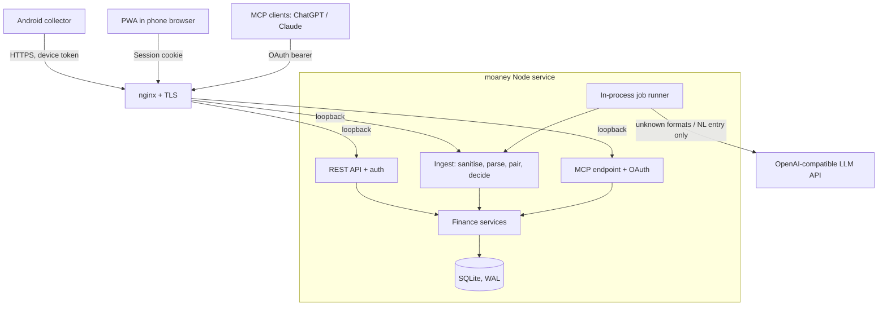

# Moaney — Personal Finance Product & Technical Specification

**Status:** Draft v0.2 (rewrite of v0.1 after design discussion)  
**Date:** 2026-10-30  
**Public URL:** `https://moaney.arfani.my.id`  
**Target:** Self-hosted, single-user, AI-assisted personal finance app  
**Primary interface:** Mobile-first installable PWA  
**Backend:** One Node 22 + TypeScript (Express) service, SQLite  
**Hosting:** Existing Oracle aarch64 VPS (operated from the `oracle-xclaw` workspace)  
**AI:** OpenAI-compatible endpoint (currently Command Code), called directly  
**Integration:** Model Context Protocol (MCP) with OAuth, reusing the Zepp MCP implementation  
**Automatic input:** Android notification collector (Tasker prototype, then a small Kotlin APK)  
**UX inspiration:** [oyenza.app](https://oyenza.app/) (capture speed and daily rhythm), without its gamification

> **Product principle:** Capture money activity with minimal effort, keep records correct and auditable, and allow corrections at any time. AI proposes; the finance engine validates and records. The database, not the LLM, is the source of truth.

### Changes from v0.1

- Stack reduced from seven services (Next.js, Express, worker, Redis/BullMQ, LiteLLM, PostgreSQL, nginx) to **one Node process with SQLite** behind the VPS's existing nginx.
- Notification feasibility confirmed for **GoPay, Jago and BCA**; the first real formats are in §7.2.
- Self-transfer pairing (one transfer seen by two apps) is a V1 requirement, not a later reconciliation feature.
- Corrections use **editable transactions + audit log + regenerated journal lines** instead of reversal/repost entries.
- UX restructured around Home / History / Reports / Wallets / Add, with a daily "close the day" review.
- Natural-language and voice entry, "Log again" chips, share target, budgets, goals and upcoming bills moved into the MVP.
- MCP is read-only in V1; write tools are deferred.
- Investment import uses one canonical CSV format; the user reshapes their spreadsheet to fit it.
- Transactions import uses one canonical CSV template (`transactions.csv`); the user converts old data (e.g. from Money Tracker) to fit it, and categories are seeded from the user's own list (§8.6).
- Old history without wallet data goes into a history-only "Before Moaney" wallet that never affects real balances; money lent to others is an asset, "Owed to me" (§8.6).
- Log-again chips are built from the user's repeat entries (description + category + usual amount); reports gain Daily / Weekly / Monthly / Yearly tabs.

---

## 1. Vision and success criteria

Expense/income tracking, wallet balances, investments and AI-based questions in one place. Most daily transactions arrive automatically from Android notifications; the user mostly reviews exceptions once a day and fixes misclassifications.

### Core user journeys

1. **Passive capture:** Pay with GoPay/Jago/BCA → the phone collector forwards the allowlisted notification → the backend parses it, pairs it with related notifications (e.g. both sides of a self-transfer) and either posts it or queues it for review.
2. **Close the day:** Home shows "N to review" → confirm, correct or reject each item → the day is marked closed.
3. **Quick entry:** Type or say `kopi 28k pakai gopay dan parkir 5k` → get editable proposals → confirm. "Log again" chips repeat frequent items with one tap.
4. **Share in:** Share a transaction text/screenshot from another app to Moaney (PWA share target) when a notification was missed.
5. **Overview:** Today's spending, month vs last month, category budgets, wallet balances, goals, upcoming bills.
6. **Investments:** Import holdings/history from the canonical CSV; record buys, sells, coupons (SBN), dividends, fees, maturities; see allocation and gains.
7. **Ask:** Ask the in-app assistant or an authorised MCP client (ChatGPT, Claude) questions answered from server-computed figures.

### Success targets

- Routine GoPay/Jago/BCA notifications need no typing when the text contains amount, direction and counterparty.
- Duplicate deliveries never create duplicate transactions.
- A transfer between own accounts never counts as income or expense, even when both apps notify.
- Every automated classification can be corrected without losing its provenance.
- All screens work well on a phone browser; the PWA is installable.
- The app stays fully usable when the LLM is unavailable.

## 2. Scope

### MVP / V1

- Single user, password login.
- Wallets: bank, e-wallet, cash, credit card, investment cash; liabilities; "Owed to me" (money lent, an asset); a history-only "Before Moaney" wallet for imported entries.
- Income, expense, transfer, refund and fee; categories (with emoji), merchants, notes.
- Android notification ingest with per-source parsers and an allowlist.
- Self-transfer pairing and duplicate detection.
- Review inbox surfaced as "close the day" on Home.
- Natural-language entry (text, plus voice via the browser's speech recognition), multiple items per sentence.
- "Log again" and "usually around now" suggestions computed from history (no AI), keyed on description + category + the amount most often used (e.g. `nasbung` → My Food, Rp16.000).
- CSV import with a downloadable template (`transactions.csv`): preview before anything is saved, and safe re-import.
- PWA share target for text and images (images stored; parsing deferred to V1.1).
- Monthly category budgets, simple savings goals, recurring bills ("Coming up").
- Reports: monthly money in/out, calendar heatmap, cumulative daily trend vs last month, category breakdown.
- Investments: instruments, trades, coupons/dividends, manual prices, canonical CSV import.
- Read-only MCP tools behind OAuth; in-app assistant using the same tools.
- CSV export, daily backup, health endpoint.

### V1.1 / V2

- Receipt/screenshot parsing with an image-capable model.
- Bank statement import and reconciliation.
- MCP proposal/write tools with in-app approval.
- Rule editor UI; budget alerts via push notification.
- Automated price/FX sources; multi-currency auto-posting.
- Offline draft entry with sync.

### Out of scope

- Storing bank credentials, scraping bank sessions, or initiating payments/transfers/trades.
- Accessibility-service workarounds on Android.
- AI writing directly to the ledger without validation.
- Multi-user/household sharing, SaaS billing.
- Gamification (streaks, coins, collectibles), story cards, transit and similar non-finance features.

## 3. Principles

1. **PWA cannot read notifications.** A separate Android collector with `NotificationListenerService` (or Tasker for the prototype) is required.
2. **Privacy first.** Collect only allowlisted packages; drop OTP/verification/security messages on the phone and again on the server.
3. **Rules before AI.** Per-source deterministic parsers and user-approved merchant rules first; the LLM only handles unknown formats and free-text entry; uncertainty goes to review.
4. **Provenance.** Every transaction records its origin: notification, manual, natural language, share, import or MCP.
5. **Auditable corrections.** Every change is written to an audit log with old and new values; nothing is silently lost.
6. **Financial correctness.** Transfers are not expenses; investment purchases are not consumption; coupons/dividends are investment income; price changes are valuation, not cash flow.
7. **Smallest thing that works.** One process, one database file. Split only when a measured need appears.
8. **IDR first, multi-currency capable.** Store original currency and amount; do not invent FX rates or prices.

## 4. Architecture



### Components

- **One Node 22 + TypeScript process** (Express): REST API, static PWA assets, ingest pipeline, MCP endpoint, OAuth server, and an in-process job runner.
- **PWA:** Vite + React + TypeScript, built to static files served by the same process. Service worker for install and cached read-only screens.
- **Database:** SQLite in WAL mode through Drizzle ORM (`better-sqlite3`, which has arm64 prebuilds). Drizzle keeps a later PostgreSQL move possible.
- **Jobs:** a `jobs` table polled in-process (LLM fallback parsing, daily backup, recurring-bill generation). No Redis.
- **LLM:** a thin OpenAI-compatible client; base URL, key and model names come from `.env`.
- **MCP:** official TypeScript MCP SDK over Streamable HTTP, with the OAuth 2.1 server ported from `zepp-cloud-mcp` (`oauth.ts`, file/DB store, consent page with owner password, PKCE, rate limits).
- **Android collector:** separate; Tasker profile first, Kotlin APK later.

### Deployment (follows the Zepp MCP pattern)

- systemd unit `moaney`, `EnvironmentFile=` the app `.env` (mode 0600), listening on a loopback port only (e.g. `127.0.0.1:8790`; confirm it is free).
- nginx server block for `moaney.arfani.my.id` proxying to that port; Certbot TLS; Cloudflare DNS-only A record to the VPS.
- Develop locally → push → `git pull --ff-only` on the VPS → restart → verify. No hand edits on the VPS.
- Back up the repo, `data/` and `.env` before each deploy, as done for Zepp.
- Follow the `oracle-xclaw` workspace rules: read `docs/operations/vps.md` first, preserve unrelated workloads, record durable lessons in a new `docs/operations/moaney.md`.

### Repository layout

```text
moaney/
  src/
    server.ts            # Express app, static PWA, health
    auth/                # owner login, sessions, CSRF
    oauth/               # ported from zepp-cloud-mcp
    mcp/                 # tools and scopes
    db/                  # Drizzle schema, migrations, repositories
    domain/              # posting, balances, budgets, goals, investments
    ingest/
      sources/           # gopay.ts, jago.ts, bca.ts (+ fixtures)
      pairing.ts         # self-transfer and duplicate matching
      sanitise.ts
    ai/                  # LLM client, schemas, NL entry
    jobs/                # runner, backup, recurring bills
  web/                   # Vite + React PWA
  test/
    fixtures/notifications/   # real, sanitised samples per source
  docs/
  collector/             # Tasker export, later Kotlin APK
```

## 5. PWA experience

Mobile-first. Bottom navigation: **Home · History · Reports · Wallets · Add**.

### Home

- Greeting and today's date; **today's total spent and number of payments**.
- **Close the day** card: items awaiting review today; one-tap confirm, correct or reject; once empty, the day is marked closed.
- Today's transactions (emoji, merchant, category · wallet, amount), collapsed after a few.
- **Usually around now** chips (frequent merchant at this hour/weekday) for one-tap logging.
- **This month:** money out so far, compared with the same day last month in one plain sentence ("Rp3.86m more than September").
- Top categories with budget progress ("Rp2.45m of Rp2.5m", over-budget warning).
- **Coming up:** recurring bills due soon.
- **Ask** box opening the assistant.

### Add

- One input: type or tap the microphone (Web Speech API, `id-ID` or `en-US`). Several items in one sentence separated by "dan"/"and"/commas.
- Result: editable proposal cards (amount, wallet, category, merchant, date, type); confirm all or individually.
- **Log again** chips: the user's most repeated entries (description, category, usual amount); one tap logs it for today.
- Manual form for full control.
- Share target: shared text is parsed like typed text; shared images are attached for later parsing (V1.1).
- Free-text parsing tries simple deterministic patterns first (`<thing> <amount>[k|rb|jt] [pakai|using <wallet>]`) and falls back to the LLM.

### History

- Grouped by day with a daily subtotal; rows are compact like Money Tracker: category, description, amount, with wallet and a source badge underneath (notification, typed, shared, import).
- Filters: period, wallet, category, type, source, status; text search.
- Multi-select for bulk recategorise/delete.
- Opening a transaction shows its details, the original notification text (while retained), linked transactions (e.g. the other side of a transfer) and the change history.

### Reports

- Period tabs: Daily, Weekly, Monthly, Yearly (as in Money Tracker). Monthly shows money out vs money in and average per day.
- **Calendar heatmap** of daily spending.
- **Cumulative daily line vs last month.**
- Category breakdown with share, per-day average and budget.
- Cash flow keeps income, expense, transfers and investment activity separate.
- Net worth and investment allocation.

### Wallets

- Total balance split into available, earmarked for goals, and owed on credit cards (with next due date).
- Wallet list with ledger balance; optional reported statement balance and its difference.
- Goals (target, progress, linked wallet).
- Investments entry point: holdings, cost basis, market value, realised/unrealised gains, coupons and dividends, price as-of dates.

### Interaction rules

- Correcting a movement between own wallets must use the **transfer** type.
- Marking an item duplicate/irrelevant/rejected keeps an audit record but has no ledger effect.
- Balances and charts include only posted transactions; anything provisional is labelled.
- The UI says "wallets", "payments", "money in/out"; double-entry stays internal.
- Indonesian and English UI strings; IDR shown as `Rp 38.500` (Indonesian) or `Rp 38,500` (English) with compact `Rp32k` / `Rp2.5m` forms.

## 6. Android notification collector

### Phase A — Tasker prototype (immediate)

- Tasker (or MacroDroid) profile: on notification from the allowlisted apps → HTTP POST JSON to `https://moaney.arfani.my.id/api/v1/ingest/notifications` with a device token header.
- Before the ingest endpoint exists, the same profile may post to a Kook receive-only endpoint to gather samples; delete them from Kook after copying the sanitised fixtures.

### Phase B — Kotlin collector

- `NotificationListenerService` with a package allowlist.
- Read the **expanded text** (`EXTRA_BIG_TEXT`, falling back to `EXTRA_TEXT`), plus `EXTRA_TITLE`, post time and package name. Lock-screen text may be truncated.
- Local filter drops OTP/verification/login/security notifications before sending.
- Local queue with retry and bounded exponential backoff; the event ID is the idempotency key.
- Pause capture, show recent failures, revoke/rotate the device token (kept in Android Keystore).

### Payload

```json
{
  "event_id": "uuid-generated-on-device",
  "device_id": "pseudonymous-device-id",
  "source_package": "com.gojek.gopay",
  "posted_at": "2026-10-30T10:25:00+07:00",
  "title": "Transfer berhasil",
  "text": "Rp10.000 udah dikirim ke BCA OWNER FULL NAME.",
  "schema_version": 1
}
```

### Limitations

- Formats change with app versions and language settings; parsers are versioned and backed by fixtures.
- OEM battery restrictions may delay delivery; `posted_at` from the phone is used for matching, not server receive time.
- A notification is not proof of settlement; reconciliation with statements comes later.

## 7. Ingestion, parsing and pairing

### 7.1 Pipeline (synchronous on receipt, except LLM fallback)

1. **Receive:** authenticate device token, rate-limit, validate with Zod, check package allowlist.
2. **Sanitise:** drop OTP/security content; mask long digit runs (account/card numbers); keep raw text only for the retention window.
3. **Idempotency:** unique `(device_id, event_id)`; repeated delivery returns the stored result.
4. **Parse deterministically:** match the source's known patterns (§7.2); output the parsing contract (§7.4).
5. **Unknown format:** enqueue an LLM extraction job; the candidate waits in review meanwhile.
6. **Pair and deduplicate:** §7.3.
7. **Validate:** amount > 0, supported currency, plausible time, known wallet, type consistent with direction.
8. **Decide:** post or queue for review (§7.5).
9. **Learn:** corrections propose merchant → category rules; the user approves before a rule becomes automatic.

### 7.2 Known sources and formats

Package names below are to be confirmed from the first collected samples.

| Source | Package (to verify) | Language / number format | Example |
|---|---|---|---|
| BCA (myBCA "Financial Diary") | `com.bca.mybca.omni.android` | English; `IDR 10,000.00` (comma thousands, dot decimals) | Title `Financial Diary` — `You received IDR 10,000.00 from ***PET **AK ***GSA at Account Transfer category.` |
| GoPay | `com.gojek.gopay` | Indonesian; `Rp10.000` (dot thousands, no decimals) | Title `Transfer berhasil` — `Rp10.000 udah dikirim ke BCA OWNER FULL NAME.` |
| Jago | TBD | TBD | Samples needed |

Observations from the first samples:

- **Number formats differ per source.** Each source parser declares its own thousands/decimal separators; there is no generic number guesser.
- **BCA masks the counterparty** (`***PET **AK ***GSA`) and adds its own category label ("Account Transfer"); the category label is a hint only.
- **GoPay names the destination bank and recipient**, which identifies transfers to the owner's own accounts.

Samples still needed: Jago money in/out/QRIS; GoPay QRIS/merchant payment, top-up, GoRide/GoFood; BCA debit/transfer out/QRIS; whether GoPay → bank transfers charge a fee and how it appears.

Each sample becomes a sanitised fixture in `test/fixtures/notifications/<source>/` with its expected parse result.

### 7.3 Pairing and duplicates

**Self-transfer pairing.** One movement between own wallets often produces two notifications (e.g. GoPay "dikirim ke BCA <owner name>" at 10:25 and BCA "You received IDR 10,000.00" at 10:25).

- Configuration: owner name aliases (e.g. `OWNER FULL NAME`) and which banks/e-wallets are owned.
- An outgoing notification whose recipient matches an owner alias at an owned institution becomes a **transfer** candidate to that wallet.
- An incoming notification on another owned wallet, same amount (or amount minus a known fee), within a time window (default ±10 minutes) is **linked as the other side**, not recorded as income.
- If only one side arrives, the transfer is still recorded from that side; the late arrival of the other side links to it instead of creating a new transaction.
- Ambiguous matches (several candidates in the window) go to review.

**Duplicates.** Same source, amount, direction and reference/merchant within a short window are flagged, not auto-dropped; two genuine identical coffees are possible.

**Top-ups.** Bank → e-wallet top-ups are transfers, paired the same way when both sides notify.

### 7.4 Parsing contract

```json
{
  "event_type": "transfer_out",
  "amount": "10000",
  "currency": "IDR",
  "occurred_at": "2026-10-30T10:25:00+07:00",
  "counterparty": "OWNER FULL NAME",
  "counterparty_institution": "BCA",
  "wallet_hint": "GoPay",
  "category_hint": null,
  "reference": null,
  "parser": "gopay.transfer_success@1",
  "evidence": ["amount", "direction", "counterparty"],
  "uncertainties": []
}
```

`amount` is a decimal string in major units as written by the source; it is converted to integer minor units (§8.1) on validation. `event_type` ∈ `expense | income | transfer_out | transfer_in | refund | fee | unknown`.

### 7.5 Candidate states and posting policy

`received → parsed → [pending_review | posted | rejected | duplicate | linked]`  
`pending_review → [posted | rejected | duplicate | linked]`  
`posted → corrected` (edit with audit, §8.4)

`linked` = attached to an existing transaction as its other side; no separate ledger effect.

| Condition | Decision |
|---|---|
| Known parser, known wallet, clear direction, unique | Auto-post (once the source is enabled for auto-post) |
| Self-transfer with unambiguous pair | Post as transfer / link |
| LLM-extracted | Review |
| Missing amount, wallet or direction; conflicting evidence | Review |
| Possible duplicate | Review; never double-post |
| OTP/security or non-financial | Reject before storage |

Start **review-first** for every source; enable auto-post per source and parser after it proves accurate on real data. Model confidence numbers alone never authorise posting.

## 8. Domain and ledger

### 8.1 Money

- Amounts are stored as **integer minor units** (`INTEGER` in SQLite; `bigint` in TypeScript) with a per-currency exponent table.
- **IDR uses exponent 2** (ISO 4217): banks report decimals (`IDR 10,000.00`) and interest/tax lines can carry sen. Rp10,000 is stored as `1000000`. The UI hides zero decimals.
- No floating-point arithmetic for money anywhere, including reports.

### 8.2 Entities

| Entity | Purpose |
|---|---|
| `users` | The owner (single row) |
| `devices` | Collector enrolment, hashed token, revocation |
| `notification_events` | Source metadata, raw text (until retention expiry), parse status |
| `candidates` | Interpreted events and review state |
| `wallets` | Bank, e-wallet, cash, credit card, investment cash, liability, receivable ("Owed to me"), history (no balance) |
| `categories` | Name, icon, kind (expense/income), optional monthly budget |
| `merchants` | Normalised merchant, default category, aliases |
| `transactions` | User-facing activity: type, amount, wallet(s), category, merchant, time, source, status, link to paired transaction |
| `journal_lines` | Debit/credit lines generated from each transaction; always balanced |
| `rules` | Approved merchant/source → category/wallet rules |
| `audit_events` | Actor, action, entity, old/new values, time, reason |
| `goals` | Target amount, linked wallet, earmarked amount |
| `recurring_bills` | Name, amount, schedule, wallet, next due |
| `attachments` | Shared images/screenshots |
| `instruments`, `investment_trades`, `investment_lots`, `prices`, `fx_rates` | Investments and valuation |
| `jobs` | In-process job queue |
| `oauth_*`, `mcp_clients` | OAuth clients/tokens (hashed) and scopes |

### 8.3 Posting

- Expense: debit expense category / credit source wallet.
- Income: debit wallet / credit income category.
- Transfer: debit destination wallet / credit source wallet; fees as a separate expense line.
- Credit card spending: credit the card liability; paying the card is a transfer.
- Buy investment: investment cash → holding at cost, fees separate.
- Sell: reduce holding at cost, record proceeds and realised gain/loss.
- Refund: linked to the original expense, not a negative expense.
- Price changes: valuation layer only.

### 8.4 Corrections

- Transactions are editable. Each edit, inside one database transaction:
  1. writes an `audit_events` row with old and new values,
  2. deletes and regenerates that transaction's `journal_lines`,
  3. keeps the original candidate and notification links.
- Deleting is a soft delete (status `void`) with an audit row.
- Balances are always derivable from `journal_lines`; any cached balance can be rebuilt.

### 8.5 Balances

- **Ledger balance:** sum of journal lines.
- **Reported balance:** optional user-entered or imported statement balance with date.
- **Difference:** shown as a reconciliation hint on the wallet.

### 8.6 Importing history

The app imports one format only: `transactions.csv`. The user converts old data to fit it. The user's current data is in Money Tracker (observed 2026-10-30: 4,772 entries from 2022-01 to 2026-10, all expenses, whole rupiah, no wallets, no income); a one-off conversion script, kept outside the app, will produce the CSV from its backup.

UTF-8, comma separated, one header row:

| Column | Example | Notes |
|---|---|---|
| `date` | `2026-10-29` or `2026-10-29 12:10` | Asia/Jakarta; time optional |
| `type` | `expense` | `expense`, `income` or `transfer` |
| `amount` | `16000` | Plain number, no thousands separators; decimals allowed |
| `wallet` | `Cash` | Source wallet; blank = "Before Moaney" |
| `to_wallet` | `Owed to me` | Transfers only |
| `category` | `My Food` | Expenses and income; blank for transfers |
| `description` | `Nasbung` | |
| `note` | | Optional |
| `external_id` | `mt-4771` | Optional; makes re-import safe |

- **Categories:** seeded from the user's own list: My Food, Family Food, Family Bill, Household, Others, Holiday, Sandang, Self Investment, Hereafter, Healing, Kuliah, Gift, Others Debt. "Hereafter" is for good deeds (donations): an ordinary expense category, reported separately. "Unpaid Debt" is not carried over as a category.
- **Wallet for old entries:** rows with a blank `wallet` go to a wallet called **Before Moaney** with kind `history`. History wallets appear in reports and charts but are excluded from balances, net worth and reconciliation. Real wallets start from a dated opening balance.
- **Debt:** entries in debt categories are not spending. Money lent is moved to the asset wallet **Owed to me**, and repayment moves it back; neither is income or expense. In the CSV, lending is a `transfer` into "Owed to me"; the user decides lent vs owed when converting the old debt entries.
- **Preview before saving:** counts, date range, wallets and categories not yet known (created only if the user confirms), rows with problems (row number and reason), and rows that already exist (same `external_id`, or same date, description, amount and wallet); nothing is written until the user confirms. Re-importing adds only new rows.
- **Mapping:** `description` → description (merchant when it matches a known one), `date` → occurred_at, `amount` → integer minor units (§8.1), source = `import:csv`.
- **Derived from history:** Log-again chips (most repeated description + category + usual amount), merchant→category suggestions, and suggested recurring bills from entries that repeat monthly (e.g. electricity, wifi, rent).
- Income is not in the backup; it arrives through the BCA/Jago notifications (e.g. salary into BCA) or manual entry.

## 9. Investments and net worth

### Supported in V1

- Instruments: Indonesian stocks, mutual funds/ETFs, SBN (ORI/SR/ST/FR), USD-denominated ETFs, gold, crypto, cash.
- Events: buy, sell, coupon, dividend, fee, deposit/withdrawal (transfers), maturity/redemption.
- Holdings, cost basis, market value, realised/unrealised gain, income received, allocation.
- Prices entered manually with an as-of time; stale prices are flagged.
- Net worth = assets − liabilities in IDR using dated FX rates; missing prices/rates are shown, never invented.

### Canonical import CSV

The user reshapes existing spreadsheets to this format; there is no column-mapping UI.

`investment_trades.csv`

| Column | Example | Notes |
|---|---|---|
| `date` | `2026-03-15` | Trade date |
| `settle_date` | `2026-03-17` | Optional |
| `account` | `Bibit` | Broker/platform wallet name |
| `instrument` | `ORI025T3` | Code or ticker |
| `instrument_type` | `sbn` | `stock | fund | etf | sbn | gold | crypto | cash` |
| `currency` | `IDR` | Instrument currency |
| `action` | `buy` | `buy | sell | coupon | dividend | fee | maturity` |
| `quantity` | `1000000` | Units, or nominal for SBN |
| `price` | `1` | Per unit in instrument currency |
| `amount` | `1000000` | Cash amount (for coupon/dividend/fee) |
| `fee` | `0` | Optional |
| `note` | | Optional |

`holdings_snapshot.csv` (for opening positions without full history): `as_of, account, instrument, instrument_type, currency, quantity, cost_basis_total, price`.

Imports run as validate → preview (errors per row, duplicates) → apply.

### Reporting rules

- Deposits to a broker are transfers, not returns.
- Buying SBN/ETF changes allocation, not monthly spending.
- Coupons/dividends are investment income.
- Gains are labelled simple (not time- or money-weighted) until those are implemented.
- USD holdings separate price change from FX change where data allows.

## 10. AI

### Uses

- Unknown notification formats → parsing contract (§7.4).
- Free-text/voice entry → proposals.
- Category/merchant suggestions.
- Assistant answers using finance tools; numbers come from server queries, never model arithmetic.
- Later: receipt/screenshot parsing.

### Configuration

- OpenAI-compatible client with `LLM_BASE_URL`, `LLM_API_KEY`, `LLM_MODEL_PARSER`, `LLM_MODEL_ASSISTANT` in `.env`. Currently Command Code (`https://api.commandcode.ai/provider/v1`), whose model IDs keep a vendor prefix; take the list from its `/models` endpoint.
- Timeouts, retry once, and a per-day request budget.
- Send only the single notification text or entry sentence plus the category/wallet names it needs — never history or raw account numbers.

### Safety

- Validate every model output with Zod; invalid output → review.
- Notification text, merchant names and shared text are data, never instructions.
- The assistant calls fixed finance tools; no free-form SQL.
- Log model, latency and outcome, not prompts.
- LLM failure → item stays in review; manual entry and deterministic parsing keep working.

## 11. MCP

- Official TypeScript MCP SDK, Streamable HTTP at `/mcp`.
- OAuth 2.1 ported from `zepp-cloud-mcp`: discovery documents, dynamic client registration limited to known redirect URIs (ChatGPT, claude.ai, localhost), PKCE S256, owner-password consent page with CSRF and rate limits, hashed tokens with rotation.
- Same finance services as the REST API; no direct database access from tools.
- V1 tools are read-only (`finance:read`, `investments:read`):

| Tool | Notes |
|---|---|
| `finance_get_summary` | Period, currency, money in/out, savings rate, data-completeness warnings |
| `finance_list_wallets` | Balances; masked identifiers |
| `finance_list_transactions` | Filters and pagination; never raw notification text |
| `finance_get_transaction` | Includes provenance and change history summary |
| `finance_get_cashflow` | Income, expense, transfers and investments separated |
| `finance_get_budgets` | Budget vs actual per category |
| `finance_get_review_queue` | Items awaiting review |
| `finance_get_portfolio` | Holdings, valuation as-of, missing prices |

- Write tools (propose/confirm) are V2 and require approval inside the PWA; an MCP call alone never confirms a financial change.

## 12. REST API (outline)

| Method | Path | Purpose |
|---|---|---|
| `POST` | `/api/v1/auth/login` / `logout` | Owner session |
| `POST` | `/api/v1/devices` | Enrol collector, returns token once |
| `DELETE` | `/api/v1/devices/:id` | Revoke |
| `POST` | `/api/v1/ingest/notifications` | Idempotent notification submission |
| `GET` | `/api/v1/review` | Review queue (optionally by day) |
| `POST` | `/api/v1/review/:id/confirm` · `/reject` · `/duplicate` | Review actions (confirm accepts corrected fields) |
| `POST` | `/api/v1/days/:date/close` | Close the day |
| `POST` | `/api/v1/entries/parse` | Text → proposals |
| `GET` / `POST` | `/api/v1/transactions` | List / create |
| `PATCH` / `DELETE` | `/api/v1/transactions/:id` | Edit / void with audit |
| `GET` | `/api/v1/suggestions` | Log-again and usually-around-now chips |
| `POST` | `/api/v1/share` | Share-target receiver |
| `GET` / `POST` / `PATCH` | `/api/v1/wallets`, `/categories`, `/goals`, `/bills`, `/rules` | Settings data |
| `GET` | `/api/v1/reports/{summary,daily,categories,networth}` | Reports |
| `GET` | `/api/v1/investments/portfolio` | Holdings and valuation |
| `POST` | `/api/v1/imports` | Upload CSV → validation preview; `/imports/:id/apply` |
| `POST` | `/api/v1/assistant/chat` | Tool-mediated assistant |
| `GET` | `/api/v1/export.csv` | Transactions export |
| `GET` | `/health` | Liveness + DB check |
| `POST` | `/mcp` | MCP endpoint (OAuth) |

Mutations validate with shared Zod schemas; create/ingest/review endpoints accept an idempotency key.

## 13. Security, privacy and operations

- HTTPS only; the service listens on loopback; nginx terminates TLS. Expect immediate scanner traffic (`/.env`, `/.git/config`) once public.
- Owner login: hashed password, `HttpOnly; Secure; SameSite=Lax` session cookie, CSRF protection, login rate limit.
- Device tokens and OAuth tokens stored hashed; revocable.
- Strict CSP with nonces, `X-Frame-Options: DENY`, `Referrer-Policy: same-origin`, `noindex`.
- `.env` and `data/` mode 0600, git-ignored; never logged.
- No bank credentials, OTPs or PINs stored or sent to the LLM; long digit runs masked.
- Raw notification text deleted after review plus a retention window (default 30 days); sanitised provenance kept.
- Audit log for edits, reviews, imports, rule changes, device and OAuth changes.
- **Backups:** daily SQLite online backup (`VACUUM INTO`) to `~/backups/moaney/` with rotation; copy off the VPS periodically; restore test before relying on it.
- JSON logs without transaction text; request IDs.
- Pin dependency versions; `npm audit` before deploy.

## 14. Milestones

### M0 — Foundation

- Repo, TypeScript, ESLint, Vitest, `.env.example`.
- Express server, SQLite + Drizzle migrations, seed the user's categories (§8.6) and starter wallets (BCA, Jago, GoPay, Cash, Before Moaney, Owed to me).
- Owner login, health endpoint, PWA shell with bottom navigation.
- systemd/nginx/Certbot deployment at `moaney.arfani.my.id`; first backup.

**Exit:** sign in on the phone; PWA installs; backup file restores.

### M1 — Ledger and manual capture

- Wallets, categories, transactions, journal lines, transfers, edit/void with audit.
- Add screen: manual form + deterministic text parsing (`kopi 28k gopay`), multiple items.
- Home (today, month vs last month), History, Wallets balances.
- `transactions.csv` importer with template download and preview, the "Before Moaney" history wallet and "Owed to me" (§8.6); Log-again chips from the imported history.
- Tests: expense vs transfer, correction regenerates lines, balances reproducible.

**Exit:** a week of manual use works on the phone; balances match the journal.

### M2 — Notifications

- Device enrolment, ingest endpoint, Tasker profile.
- GoPay, BCA and Jago parsers with fixtures; self-transfer pairing; duplicate flags.
- Close-the-day review on Home; review-first mode.

**Exit:** the 10:25 GoPay → BCA example produces one transfer, not income + expense; resending an event 10 times creates one record.

### M3 — AI, suggestions and polish

- LLM fallback for unknown formats and free-text entry; voice input; share target.
- Log-again and usually-around-now chips; merchant rule suggestions.
- Budgets, goals, recurring bills; Reports (heatmap, cumulative trend, categories).
- Per-source auto-post switch.

**Exit:** new formats and plain-language entry yield validated proposals; LLM outage changes nothing but the fallback.

### M4 — MCP and assistant

- OAuth port from Zepp; read-only tools; in-app Ask box using the same tools.
- Test with ChatGPT and Claude connectors.

**Exit:** "How much did I spend on food in October, excluding transfers?" is answered correctly by an MCP client.

### M5 — Investments

- Canonical CSV import with preview; trades, coupons, dividends, manual prices, FX.
- Portfolio and net-worth views.

**Exit:** imported holdings match the spreadsheet totals.

### M6 — Hardening

- Kotlin collector; retention automation; restore drill; parser accuracy metrics per source.
- Statement import and reconciliation (V1.1 start).

## 15. Acceptance scenarios

1. **Expense:** a GoPay QRIS payment of Rp35,000 produces one expense and lowers the GoPay balance by Rp35,000.
2. **Idempotency:** the same device event sent 10 times yields one candidate and at most one transaction.
3. **Self-transfer pairing:** GoPay `Rp10.000 udah dikirim ke BCA OWNER FULL NAME.` and BCA `You received IDR 10,000.00 …` at the same minute produce **one** transfer GoPay → BCA; income and expense totals are unchanged.
4. **One side only:** if only the GoPay side arrives, a transfer is still recorded; a later BCA notification links to it.
5. **Number formats:** BCA `IDR 10,000.00` and GoPay `Rp10.000` both parse to 1,000,000 minor units.
6. **Ambiguity:** a notification without a clear amount or direction stays in review and affects no balance.
7. **Correction:** changing a posted expense to a transfer updates both wallet balances and reports, and the history shows the original values, editor and time.
8. **Security:** an OTP notification is rejected, never stored and never sent to the LLM.
9. **LLM outage:** manual entry, deterministic parsing and review keep working.
10. **Multi-item entry:** `kopi 28k dan parkir 5k pakai gopay` yields two proposals on GoPay.
11. **Portfolio:** buying an ETF reduces investment cash, increases the holding and does not count as spending.
12. **Currency:** a USD holding shows original currency, FX rate and as-of time; missing data is flagged.
13. **MCP read:** an authorised client gets October food spending without seeing raw notification text.
14. **Recovery:** a backup restored into an empty data directory reproduces the same balances.
15. **Import:** importing the converted history CSV (about 4,772 rows) shows its row count, date range and new categories in the preview before saving; after confirming, the rows with a blank wallet are present once in "Before Moaney" and no real wallet balance changes. Importing the same file again adds nothing.
16. **Debt:** marking money lent as "Owed to me" lowers the paying wallet and raises Owed to me; spending and income totals do not change.
17. **Log again:** after import, `nasbung` is offered as a chip with category My Food and its most common amount.

## 16. Open decisions

1. **Remaining notification samples:** Jago (all types), GoPay payments/top-ups/Gojek services, BCA debits, transfer fees.
2. **Owner name aliases and owned institutions** for pairing (initially `OWNER FULL NAME`; BCA, GoPay, Jago).
3. **Auto-post enablement:** per source/parser after a measured review period.
4. **Opening balances:** dated opening-balance entries per wallet on the start date.
5. **Retention window** for raw notification text (default 30 days).
6. **Voice input privacy:** the browser's speech recognition on Android Chrome sends audio to Google; acceptable, or prefer typing only / a self-hosted transcription later.
7. **Loopback port** for the service on the VPS.
8. **Debt direction:** confirm whether the debt entries are money lent to others (asset, "Owed to me") or money owed.
9. **Salary timing:** confirm income arrives in BCA and on which day, to suggest it as a recurring income.
10. **Conversion script:** a one-off script (outside the app) that turns the Money Tracker backup into `transactions.csv`; to be written after M1.

## 17. First implementation prompt

> Build milestone M0 and M1 of `PERSONAL_FINANCE_SPEC.md` (Moaney). One Node 22 + TypeScript Express service serving a Vite + React PWA, SQLite (WAL) via Drizzle with `better-sqlite3`, Vitest. Implement owner login with secure sessions and CSRF, wallets, categories with emoji, transactions with generated balanced journal lines, transfers, edit/void with audit events, deterministic text entry (`kopi 28k gopay`, multiple items with "dan"/"and"), and Home/History/Wallets/Add screens with a bottom navigation. Store money as integer minor units with a currency exponent table (IDR = 2); no floating point. Include migrations, seed data, unit tests (expense vs transfer, correction regenerates lines, balances reproducible), `.env.example`, a systemd unit and nginx server block template for `moaney.arfani.my.id` on loopback, and a README with local and VPS steps. No LLM, MCP or notification ingest yet.

---

**Note:** Notification formats change between app versions; parsers are only as good as their fixtures. Keep review-first mode until each source is measured on real data.
